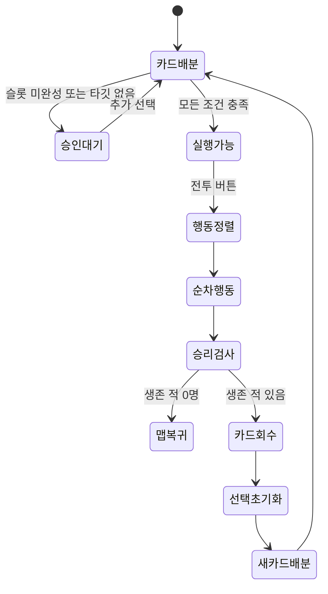

# 구현 현황

## 검증 기준

- 확인일: 2026-11-02. 현재 작업 트리 기준이며, 과거 커밋 기준점과 구분한다.
- Unity `6000.3.11f1` / uGUI / URP. 일반 검증은 C# 컴파일이며, 컴파일 성공만으로 시각·게임플레이 정확성을 주장하지 않는다.
- 최근 제한 검증: 타이틀·로비·준비·맵·전투·상점 전환, 맵 회전/설명창/카드 겹침, 전투 배속·스킵 결과 일치, 처치·승리 보상·맵 복귀, 전투 선택창의 빈/선택 상태와 글자 비율 확인.
- 전투 시간 측정은 통제된 아군 3명+적 4기 비처치 턴에서 1x 약 2.79초, 2x 1.44초, 3x 0.89초다. 모든 전투의 고정 시간이 아니다.
- 실제 마우스 조작 전수 검사, 다양한 해상도, 출시 빌드와 실기기 성능·전체 밸런스는 미검증이다.
- Build Settings: 기존 Title(0), Map_1F(1), Playing_Scene(2), Shop(3), Lobby(4), Preparation(5) 보존. Map_2F~Map_5F를 6~9에 등록.
- 상세 근거: [[03 개발 기록/2026-11-01 단말 디자인 시스템]], [[03 개발 기록/2026-11-01 전투 연출 파이프라인]], [[03 개발 기록/2026-10-15 저장·계속하기·삭제]].

## 기능 매트릭스

| 영역 | 기능 | 상태 | 근거 |
|---|---|---:|---|
| 카드 | 진입 페이드 완료 후 총 6장 배분, 숫자 카드와 선택적 특수 카드 `T` 생성 | 🟢 구현 | `CardSpawner.Start()`와 씬 직렬화 값 |
| 카드 | 카드 호버·선택·소유 슬롯 제어 | 🟢 구현 | `Card`, 선택 매니저 3종 |
| Front | 카드 1장 + 공격/방어 선택 | 🟢 구현 | `FrontCardSelectionManager` |
| Middle | 속성/특수 카드 + 숫자 2장 + 물리/마법 모드 | 🟢 구현 | `MiddleCardSelectionManager` |
| Back | 일반 카드 2장으로 행동 승인 | 🟢 구현 | `BackCardSelectionManager` |
| 전투 | 모든 포지션·타깃 조건 통합 승인 | 🟢 구현 | `BattleAccessManager` |
| 전투 | 속도 기반 아군·적 행동 정렬 | 🟢 구현 | `BattleExecuteManager` |
| 전투 | 각 행동 후 생존 적 0명 판정과 승리 처리 | 🟢 구현 | `AreAllEnemiesDefeated()` → `FinishBattle(Success)` → 결과 화면 → 맵 복귀 |
| 전투 | 아군 전멸·패배 판정 | 🟢 구현 | 재배치 턴 처리 후 활동 가능한 대원 0명 → `FinishBattle(Failure)` |
| 전투 | 성공/실패 결과 화면 | 🟢 구현 | `BattleResultPresenter`와 결과 TMP·CanvasGroup이 씬에 연결됨 |
| 전투 | 일반 라운드 임시 보너스 초기화 | 🟢 구현 | 다음 카드 배분 전에 초기화 호출 복구. 성공/실패는 `FinishBattle()`에서 초기화 |
| 대원 | 퇴각 유지·부활·예약 재배치 | 🟡 부분 구현 | Front 퇴각·1턴 예약 재배치 제한 검증 통과. 예약/부활을 호출하는 실제 스킬·정책은 미구현 |
| 전투 | 물리/마법 피해와 방어 계산 | 🟢 구현 | `Operator`, `Enemy` |
| 전투 | Front 임시 공격/방어 보너스 | 🟢 구현 | `ApplyBattleBonus` |
| 전투 | Back 자동 회복 대상 선정 | 🟢 구현 | `AllyTargetingManager` |
| 적 | 4개 위치 스폰 포인트와 생성 | 🟢 구현 | `EnemySpawnManager` |
| UI | 대원 클릭 포커스, 감속, 정보 패널 | 🟢 구현 | `OperatorFocusManager` |
| 맵 | 1~5층 연결 그래프와 현재 위치 | 🟢 구현 | 1층 기존 8개, 2·3층 27개, 4·5층 64개. 세 축+면 대각선, 저장 MapFloor 복원 |
| 맵 | 궤도 카메라, 노드 포커스, 선택지 UI | 🟢 구현 | `MapOrbitCamera`, `MapNodeFocusObject` |
| 입력/UI | 선택지 EventSystem 포인터 처리와 맵 클릭 차단 | 🟢 구현 | `MapChoiceButton`, `MapChoiceHoverEffect`, `MapNodeClickHandler` |
| 씬 전환 | Battle 노드 선택 후 `Playing_Scene` 비동기 로드와 양쪽 페이드 | 🟢 구현 | `MapChoice`, `MapBattleSceneLoader`, `BattleSceneFadeIn`과 씬 참조 |
| 씬 전환 | 승리 후 현재 층 `Map_nF` 비동기 복귀와 맵 진입 페이드 | 🟢 구현 | `BattleToMapSceneLoader`, `MapSceneFadeIn`과 씬 참조 |
| 맵 | 복귀 시 마지막 현재 노드 ID 복원 | 🟢 구현 | `MapRunState`, `MapPlayerPositionFeedback` |
| 로딩 UI | 맵 퇴장/전투 진입 CanvasGroup, 문구와 점 애니메이션 | 🟢 구현 | 양쪽 CanvasGroup·TMP 참조 연결 |
| 씬 전환 UI | 공통 단말 스캔 와이프·로그·오디오 페이드 | 🟢 구현 | TransitionManager, UITheme의 0.25초 와이프/0.3초 오디오, 입력 차단. 실제 오디오 클립 청취는 남음 |
| 스킬 | JSON 정의·자연 SP 충전 | 🟡 부분 구현 | 실제 아군/적 공격마다 충전 경로 연결. 현재 대원 skillIds는 비어 있으며 실제 효과 미구현 |
| 속성 | 5개 속성 분류와 UI | 🟡 부분 구현 | 계산 결과가 현재 대부분 동일 |
| 이벤트 | 카드 검증 사건·층별 난도/비용/확정 보상·일반 사건 풀 | 🟢 구현 | EncounterCatalog/Journal/Service/Window, 2,500개 패·비용·중복 차단·저장/제한 UI 검증 |
| 상점 | Shop Scene·7종 구매·판 전체 소유·고정 강화·보상 | 🟢 구현 | 맵 진입/복귀/재입장·구매/거절 제한 검증 통과. 소유·구매 이력 저장 포함, 실제 포인터·시각 QA 별도 |
| 런 | Packet 지갑·승리 보상 | 🟢 구현 | `MapRunState.Progression` 초기 30 Packet, 승리 8 Packet, 패배 없음. 제한 씬 검증 통과 |
| 런 | Layer 경험치·레벨업 재화 | 🟢 구현 | 승리 12 EXP, 요구치 ceil(16×1.5^(Layer-1)), 단계마다 10 Packet. 경계값·다중 상승·유지 검증 통과 |
| UI | Packet·Layer·경험치 TMP HUD | 🟢 구현 | 맵/전투 우측 정렬 HUD와 EXP 막대. 실제 승리 보상 확정 후 EXP 이동/표시 갱신, 제한 캡처 확인 |
| 게임 흐름 | `Map_1F` → 전투 → 승리 → 현재 노드로 복귀 | 🟢 구현 | 현재 작업 트리의 코드·씬 호출 경로 연결 |
| 게임 흐름 | Title → Lobby와 메뉴 모달 | 🟢 구현 | 기존 OnlyAI UI 복원 및 당시 제한 검증 기록. 현재 새 게임의 준비 경로는 아래 항목을 따른다 |
| 게임 흐름 | 새 게임 → Preparation → 작전 시작 → Map_1F | 🟢 구현 | 2026-11-01 추가. 고정 편성·등록 대원 목록 서랍·HP/ATK/DEF·STAGE 00. 시작 시에만 초기화하며 취소/계속하기는 기존 판 보존. 제한 전환/서랍 검증 통과 |
| 실행 검증 | 양방향 전환·입력 차단·복귀 위치 | 🟢 제한 검증 | 배치 플레이의 맵→전투→승리→맵, 시간 정지·입력 차단·결과 화면·노드 5 복원 통과. 픽셀/마우스 판정 미검증 |
| 런 상태 | 아군·노드·승패·Packet/Layer/EXP·Cache/구매 이력 | 🟢 구현 | 현재/방문/완료 노드와 마지막 승패 기록, 새 게임 초기화와 디스크 복원. 향후 루트/엔딩 상태는 별도 |
| 데이터 | OnlyAI 기반 JSON 및 현재 main 규칙 통합 | 🟢 구현 | 대원/적/스킬·7종 Cache·가격·보상/진행/카드/Front·메뉴/맵/상점 문구. 참조 검증과 EditMode 18개 통과 |
| 저장 | Map 슬롯 선택 저장·로비 계속하기·확인 삭제 | 🟢 구현 | 기본 10개/+10개 페이지, 페이지 유지, 덮어쓰기 확인/선택 계속·삭제. 기존 1번 보존, 동일 판 전체 종료, 데이터/제한 UI 이벤트 검증 통과 |
| UI | Map 설정의 저장/저장 후 나가기 | 🟢 구현 | 좌측 상단 설정과 단말 테마 오버레이, 기본 저장 버튼 숨김. 닫기·슬롯 선택 취소/완료 복귀·저장 후 로비 제한 UI 검증 통과 |
| 런 | 무결성·정합성 사용자 HP | 🟢 구현 | 각 100%, 전원 퇴각 시 생존 적당 무결성 -10%p. 정합성 손실 이월 API, Map 숫자 TMP·저장 v2/v1 호환 |
| 저장 | 무결성 소진 사출 시 종료 처리 연결 | 🟢 구현 | 무결성 0%면 같은 판의 저장 종료 처리, 결과 화면 후 로비. 이전 파일 계속하기 차단 |
| 엔딩 | 5층 최종 보스 → 노멀 엔딩·저장 종료 | 🟢 구현 | 종료 슬롯 거절·로비 복귀 제한 검증. 이름 미정, 히든 6·7층/조건 미구현 |
| UI | UITheme·공통 단말 컴포넌트·6개 화면 테마 | 🟢 구현 | 단말 디자인 시스템 적용 및 제한 화면 왕복/캡처 확인 |
| 전투 연출 | 5단계 AttackSequence·확정 OnImpact·1회 커밋 | 🟢 구현 | 일반/Animation Event/재진입/중복/스킵 경로의 커밋 게이트 검사 |
| 전투 연출 | 카드 숫자 이동·피해/회복·피격·슬롯별 프로파일·지연 HP | 🟢 구현 | BattleFeedbackDirector, CombatFeedbackPool, CombatSpriteVisual 및 Resources/CombatFeedback |
| 전투 연출 | 1x/2x/3x·안전한 스킵·흔들림/히트스톱/섬광 설정 | 🟢 구현 | 배속·타격 전후 스킵의 실제 HP/행동 순서 일치, 일시정지 및 포즈 복원 확인 |
| 전투 UI | 선택창 가림·숫자/문구 글자 비율 복구 | 🟢 구현 | Playing_Scene 기록 HUD 전체 제거, 바탕→슬롯→아이콘→텍스트 정렬, 부모 비균등 배율 상쇄 |
| 전투 UI | SR/AT/DF 전경·AT/DF 선택 표현 통일 | 🟢 제한 검증 | 패널 20000/글자 20006, 카드 호버보다 위·모달보다 아래. Unlit 색 보존, 선택 대비·초기화·중복 이벤트·카드 클릭 관통 검사. 실제 하드웨어 클릭/해상도 전수 QA 별도 |
| 연출 자산 | 실제 효과음·공격 애니메이션 클립 | 🟡 기반 구현 | 사운드 슬롯·Animation Event 릴레이는 준비. 클립 지정/실제 클립 검증은 남음 |
| 맵 보상 | 우연한 만남·디펜더 유물 | 🟢 구현 | 검증/수령·보급/복구/백업·통과, 완료 중복 차단. 2층 끝 무료 유물 1회 |
| 상점 | 전환 후 구매 버튼 복구 | 🟢 구현 | 전환 상태/소유 수 변경 시 갱신. 레이캐스트·포인터 구매 검사 통과 |
| 저장 | v5 층별 Scene·캠페인·사건 원장 복원 | 🟢 구현 | v1~v4 호환, 층/Scene 목적지 검증, 사건 검증 단계 보존. Scene 분리는 Edit Mode 자산/데이터 검사 |

상태 판정과 Obsidian 표시법은 [[00 프로젝트/상태 표기 규칙|상태 표기 규칙]]을 따른다.

## 현재 완성된 전투 루프

## 다음 통합 이정표

1. 제한 검증 범위를 넘어선 맵/전투의 실제 마우스 조작·해상도별 시각 QA
2. 결과 화면·퇴각·재배치의 마우스/시각 QA, 부활·재배치 예약의 실제 스킬 연결
3. 히든 6·7층 해금 조건·유물별 분기와 엔딩 고유 이름 확정 (5층 노멀 엔딩/저장 종료 완료)
4. 현재 단말 전환의 화면 비율 검증, 필요 시 별도 로딩 이미지 아트 결정
5. 우연한 만남 추가 콘텐츠·이벤트 전투/맵 변형 및 정식 밸런스 (카드 서명 검증·층별 비용/보상·기본 풀 완료)
6. 저장/로비/상점의 실제 포인터 및 해상도별 시각 QA (Back Healer 공식 연결 완료)
7. 속성별 차별화된 피해/상태 효과
8. `OperatorSkill`을 행동 루프에 연결

최신 층 설계·검증 범위: [[01 시스템/층 진행과 엔딩]].

최신 우연한 만남 구현·검증·남은 범위: [[01 시스템/우연한 만남]].

층별 독립 Scene 생성·편집/확장 방법과 이번 검증 범위: [[01 시스템/층별 Scene 관리]]. 이번 분리는 C# 컴파일·Edit Mode 자산/저장 검사까지이며 Play 검증은 미실행이다.
