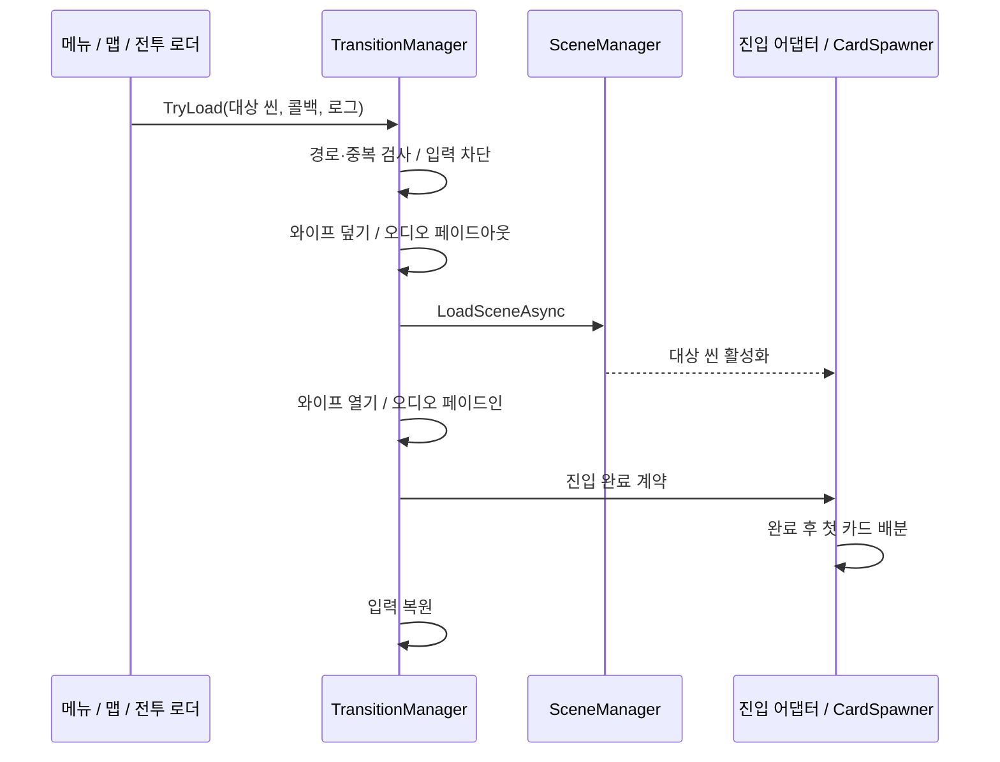

# 씬 전환 및 로딩

## 현재 전환 구조

`TransitionManager`가 씬 활성화·입력 차단·단말 전환·AudioSource 페이드를 소유한다. 매니저와 오버레이는 DontDestroyOnLoad로 유지하며 별도 Loading 씬은 사용하지 않는다. 이전 씬별 검은 오버레이의 독립 인계 설명은 현재 구조에 해당하지 않는다.

- `TryLoad`는 로드 가능 경로를 확인하고 중복 전환을 거절한다.
- UITheme의 0.25초 스캔라인 와이프와 짧은 로그 한 줄을 사용한다. 오디오 페이드는 0.3초이며 실제 클립 연결/청취 평가는 별도다.
- 전환 중 Selectable 상태와 포인터 입력을 차단하며, 직접 입력을 읽는 코드도 IsBusy를 확인한다.
- 시간 정지 상태에서도 전환 연출은 unscaledDeltaTime으로 동작한다.
- MenuSceneLoader, MapBattleSceneLoader, BattleToMapSceneLoader, ShopSceneRouter는 공통 전환 경로를 사용한다. 기존 FadeIn 어댑터의 IsFadeComplete 계약을 유지하여 첫 카드 배분 시점을 보존한다.

## 게임 흐름과 상태

- 새 게임: Title → Lobby → Preparation → 작전 시작 → Map_1F. 준비 취소는 기존 판을 초기화하지 않는다.
- 계속하기: 저장된 런 상태를 복원하고 Map으로 진입한다. [[01 시스템/저장과 이어하기]] 참고.
- 전투: 각 행동 뒤 승리 검사 → 처치/승리 연출 → 실제 승리 보상 → 결과 화면 → 맵 복귀. 무결성 소진으로 판이 종료된 경우에는 로비로 복귀한다.
- MapRunState는 현재/방문/완료 노드, 마지막 승패, 편성, 재화/경험치, Cache, 기록 HP 등을 유지한다. 디스크 저장은 별도 저장 서비스가 담당하며 단순 static 노드 ID 보존과 구분한다.
- Build Settings 인덱스는 Title 0, Map_1F 1, Playing_Scene 2, Shop 3, Lobby 4, Preparation 5를 유지하고 Map_2F~Map_5F를 6~9에 추가했다. 층 이동·전투/상점 복귀·이어하기는 `CampaignScenes`의 층별 경로를 사용한다. [[01 시스템/층별 Scene 관리]] 참고.

## 검증 범위와 남은 작업

- 과거 성공/패배 복귀 및 노드 복원 검증에 더해 2026-11-01에는 타이틀·로비·준비·맵·전투·상점 왕복, 잘못된 경로/중복 요청 거절, 시간 정지 중 전환을 제한 검증했다.
- 이후 전투 연출 검증에서도 마지막 적 처치와 승리 보상 1회 지급 후 맵 복귀를 확인했다.
- 실제 오디오 클립 청취, 모든 마우스 입력·해상도·실기기·출시 빌드 검증은 남아 있다.
- 별도 로딩 이미지 아트는 미확정이다. 현재 단말 와이프는 동작하는 연출이며, 이미지 선정 완료를 뜻하지 않는다.
- 전환 실패를 사용자에게 알리는 오류·재시도 화면은 별도 작업이다.

상세: [[03 개발 기록/2026-11-01 단말 디자인 시스템]], [[03 개발 기록/2026-11-01 전투 연출 파이프라인]].
