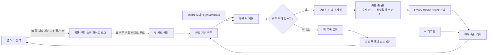

---
aliases:
  - RSR Wiki Home
tags:
  - project/randint-strategy-record
  - hub
status: active
updated: 2026-11-02
---

# 랜드인트 작전기록

> [!summary] 현재 상태
> **Randint Strategy Record**는 명일방주 세계관 기반 팬게임 프로토타입이다. Title → Lobby → Preparation → Map, 카드 선택형 전투, 상점과 다중 슬롯 저장/이어하기가 연결되어 있다. 단말 디자인 시스템과 5단계 전투 연출을 적용했으며, 최근 제한 검증에서 배속·스킵 간 전투 결과 일치와 승리 보상/맵 복귀를 확인했다. 실제 사운드 클립, 속성/스킬 효과, 히든 6·7층/조건·고유 보스 패턴과 출시 빌드·실기기 검증은 남아 있다.

## 바로가기

- [[00 프로젝트/답변이 필요한 항목|답변이 필요한 항목 — 사용자 결정 대기]]
- [[03 개발 기록/2026-10-02 현재 상태 기준점|현재 상태 플래그 · RSR-2026-10-02-01]] — `8285557` 당시의 역사적 기준점. 최신 상태는 구현 현황과 아래 2026-11-01 기록을 우선 확인한다.
- [[AI 주의사항|AI 주의사항 — 모든 AI와 협업자 필독]]
- [[00 프로젝트/프로젝트 개요|프로젝트 개요]]
- [[00 프로젝트/구현 현황|구현 현황]]
- [[00 프로젝트/상태 표기 규칙|상태 표기 규칙]]
- [[TODO LIST/TODO LIST|TODO LIST]]
- [[캐릭터/캐릭터 인덱스|캐릭터 인덱스]]
- [[01 시스템/전투 시스템|전투 시스템]]
- [[01 시스템/카드 시스템|카드 시스템]]
- [[01 시스템/대원·적·스킬|대원·적·스킬]]
- [[01 시스템/맵 시스템|맵 시스템]]
- [[01 시스템/상점 시스템|상점 Cache·Packet 데이터]]
- [[01 시스템/씬 전환 및 로딩|씬 전환 및 로딩]]
- [[02 데이터/현재 데이터 카탈로그|현재 데이터 카탈로그]]
- [[03 개발 기록/씬과 코드 구조|씬과 코드 구조]]
- [[03 개발 기록/미구현·주의사항|미구현·주의사항]]
- [[로직트리/세부 로직트리.canvas|세부 로직트리 Canvas]]

## 최근 변경 · 2026-11-02

- [[01 시스템/층별 Scene 관리|1~5층 독립 Scene · 층별 복귀/이어하기 경로 · 저장 v5]]

- [[01 시스템/우연한 만남|서명이 일치하지 않는 복구 요청 · 층별 카드 검증/확정 보상 · v4 사건 저장]]

- [[01 시스템/층 진행과 엔딩|1~5층·디펜더·중간/최종 보스·노멀 엔딩·상점 수정]]
- [[03 개발 기록/2026-11-01 단말 디자인 시스템|단말 디자인 시스템·배경·카드 렌더링]]
- [[03 개발 기록/2026-11-01 전투 연출 파이프라인|공격 연출·배속·스킵·전투 선택창 수정]]
- Playing_Scene의 기록 HUD는 제거했다. 맵에서 무결성/정합성을 확인하며, 전투 선택창은 슬롯·아이콘·숫자 순서와 글자 비율을 복구했다.
- 일반 검증은 컴파일 중심이다. 기록에 명시된 제한 런타임/시각 확인만 검증 완료로 본다.

## 시스템 관계



## 볼트 구조

```text
wiki/
├─ 랜드인트 작전기록 대문.md
├─ AI 주의사항.md
├─ 00 프로젝트/
│  ├─ 프로젝트 개요.md
│  ├─ 구현 현황.md
│  └─ 상태 표기 규칙.md
├─ 01 시스템/
│  ├─ 전투 시스템.md
│  ├─ 카드 시스템.md
│  ├─ 대원·적·스킬.md
│  ├─ 맵 시스템.md
│  └─ 씬 전환 및 로딩.md
├─ 02 데이터/
│  └─ 현재 데이터 카탈로그.md
├─ 03 개발 기록/
│  ├─ 씬과 코드 구조.md
│  └─ 미구현·주의사항.md
├─ TODO LIST/
│  └─ TODO LIST.md
├─ 캐릭터/
│  ├─ 적/
│  ├─ 아군/
│  ├─ 스킬/
│  └─ 직군/
└─ 로직트리/
   └─ 세부 로직트리.canvas
```

## 문서 원칙

- 모든 AI와 신규 협업자는 작업 전 [[AI 주의사항]]을 먼저 읽는다.
- 🟢 **구현**: 현재 씬과 코드에서 호출 경로가 확인된 기능
- 🟡 **부분 구현**: 데이터 또는 기반 클래스는 있으나 전체 플레이 흐름에 연결되지 않은 기능
- 🔴 **미구현**: 코드상 실제 결과를 만드는 처리가 없는 기능
- Unity 영역과 Wiki는 기본적으로 읽기 전용으로 다룬다. Wiki는 User가 명시적으로 갱신을 요청한 작업에서만 수정한다.
